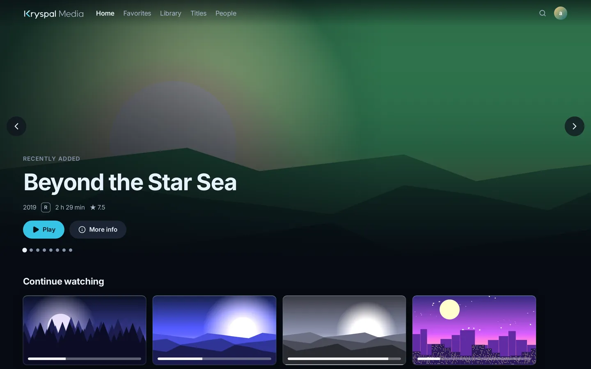

<p align="center">English | <a href="README.zh-CN.md">简体中文</a></p>

<p align="center">
  <picture>
    <source media="(prefers-color-scheme: dark)" srcset="assets/logo-dark.svg">
    
  </picture>
</p>

<p align="center"><strong>The media server that stays fast at any library size.</strong></p>

<p align="center"><em>Self-hosted, original quality, and instant with nearly 200,000 movies.</em></p>

<p align="center">
  <a href="https://github.com/kryspal/kryspal-media/releases"></a>
  
  
  
  <a href="https://github.com/kryspal/kryspal-media/discussions"></a>
</p>

<p align="center"><strong>Website: <a href="https://media.kryspal.net/">media.kryspal.net</a></strong></p>

<p align="center"><strong><a href="https://demo.kryspal.net/?lang=en">Live demo</a></strong>: browse a sample library and the admin console in your browser. Sample data only.</p>

<!-- latest:start -->
> **Latest release: [0.9.9-beta](https://github.com/kryspal/kryspal-media/releases/tag/v0.9.9-beta)** · 2026-10-23
>
> - Network storage over WebDAV, free: add a NAS, rclone or OpenList address and play without mounting it.
> - Plugin settings per library, with a Scrape again button when a change could affect results.
> - Smoother danmaku, off by default, with a clear loading state.
>
> [All releases](CHANGELOG.md)
<!-- latest:end -->

<p align="center"></p>

## Why we built it

- Browsing and filtering slowed down as our libraries grew, and scans took hours.
- Cloud-mounted libraries got rate-limited, and we feared for our drive accounts.
- Servers built for transcoding maxed out our NAS CPU, though players can direct play.
- Messy file names split one film into many entries and mixed up its versions.
- Core features sat behind online accounts, so going offline broke things.

Kryspal Media fixes each of these.

## Under the hood

- **A Go server.** One static binary, light on memory and CPU, even on a NAS.
- **PostgreSQL does the work.** Queries, sorting and filtering run in the database.
- **Fast search.** Trigram and bigram indexes in PostgreSQL.
- **Native media parsing.** A Go parser reads MKV and MP4 and extracts embedded subtitles.
- **Remux, not transcode.** Browser playback only repackages, and converts audio if needed. Video is never re-encoded.
- **Audio fingerprints.** Intros and outros are matched across the whole season (PRO).
- **Isolated, signed plugins.** Separate processes over gRPC; signed catalog, verified hashes.
- **Hardened.** Runs as non-root; release binaries are signed and self-checked.

## Features

- **Fast on huge libraries.** Nearly 200,000 movies, browsing in under 50 ms (NAS test).
- **Original quality.** Direct play keeps 4K, HDR and lossless audio. No video transcoding.
- **Cloud-drive friendly.** Play `.strm` files from your own cloud drive; direct links on your LAN (PRO).
- **Works with your players.** 3rd-party players for Emby and Jellyfin (12); import from either.
- **Tidy, even with messy names.** Flexible layouts, version grouping, and name recognition (PRO).
- **Skip intros and outros.** Mark them by hand, or detect them automatically (PRO).
- **Members and parental controls.** Separate history per member; viewing hours (PRO).
- **Backup and restore.** Manual backups can be password-encrypted (PRO).
- **Plugins and an open SDK.** Open-source plugins, and an Apache-2.0 Plugin SDK to write your own.
- **No account needed.** An email and a key. FREE is a complete media server.

## Install

```sh
curl -fsSL https://media.kryspal.net/install.sh | bash -s -- --media /srv/media
```

Replace `/srv/media` with your media folder. Repeat `--media` for more folders.

On a NAS, use the [`compose.yaml`](compose.yaml) in this repository (it pins the latest release; set your media folder in it) or follow the [installation guide](https://media.kryspal.net/docs/install/).

Two containers (server and PostgreSQL), one Docker Compose file. Requires Docker with Compose v2 on 64-bit Linux (amd64 or arm64); 4 GB RAM recommended.

[Releases](https://github.com/kryspal/kryspal-media/releases)

## Plans

FREE, PRO and MAX: see [Pricing](https://media.kryspal.net/pricing/).

## Plugins

Open source: [tmdb](https://github.com/kryspal/plugin-tmdb), [fanart](https://github.com/kryspal/plugin-fanart), [dlna](https://github.com/kryspal/plugin-dlna), [opensubtitles](https://github.com/kryspal/plugin-opensubtitles), [assrt](https://github.com/kryspal/plugin-assrt), [introdb](https://github.com/kryspal/plugin-introdb).

Write your own with the [Plugin SDK](https://github.com/kryspal/plugin-sdk). Bugs in a plugin go to that plugin's repository.

## Help

[Docs](https://media.kryspal.net/docs/) · [Discussions](https://github.com/kryspal/kryspal-media/discussions) · [Issues](https://github.com/kryspal/kryspal-media/issues) · [SUPPORT.md](SUPPORT.md)

Kryspal Media is proprietary software. This repository holds releases, the issue tracker and discussions; it does not contain source code.
